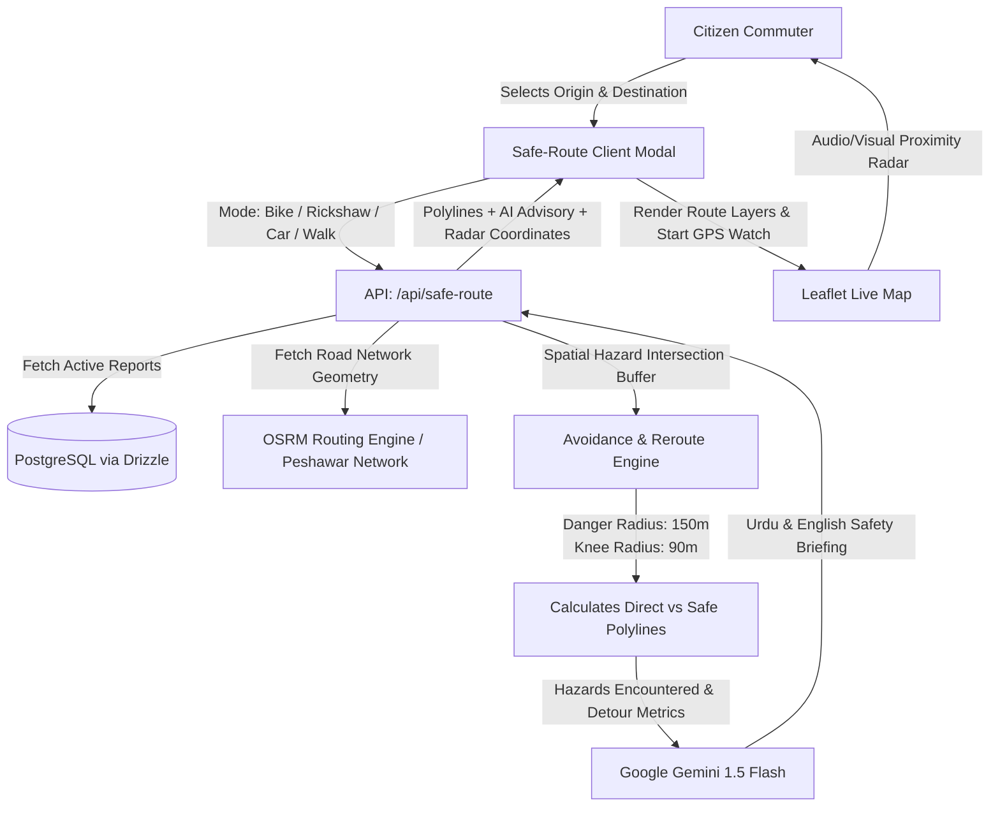

# 🗺️ NaaliWatch Safe-Route & Hazard Avoidance Architecture (محفوظ راستہ)
### Google Developer Groups (GDG) Buildathon / Hackathon 2026

## 1. Executive Overview

During seasonal monsoon downpours and flash flooding in Peshawar, streets turn into perilous waterways. The most fatal risks stem from **submerged open manholes** and **choked drains** hidden beneath floodwater, particularly endangering motorcyclists, auto-rickshaws, and pedestrians.

The **AI Safe-Route Navigator ("محفوظ راستہ")** extends NaaliWatch from a reactive reporting platform into a **proactive, life-saving mobility engine**. It empowers commuters to navigate around active flood zones and dangerous open manholes in real-time.

---

## 2. Technical Design & Data Flow

---

## 3. Hazard Avoidance Buffer Radii

| Hazard Severity / Type | Exclusion Buffer Radius | Penalty Cost Factor | Commuter Safety Action |
|---|---|---|---|
| **Danger / Open Manhole** | 150 meters | $\infty$ (Strict No-Go Zone) | Automatic hard detour around sector |
| **Knee-Deep Standing Water** | 90 meters | 5.0x penalty | Avoided for bikes & pedestrians |
| **Ankle-Deep / Blocked Drain** | 45 meters | 1.8x penalty | Caution advisory flagged |

---

## 4. Multi-Modal Travel Profiles

1. **🏍️ Motorcycle & Qingqi Rickshaw**:
   - Highest vulnerability to manhole plunges and engine drowning.
   - Strict avoidance of any point within 150m of active `danger` or `knee` severity reports.
2. **🚗 Car & Emergency Vehicle**:
   - Permits ankle and knee water if bypass is excessive, but strictly diverts around deep open manholes.
3. **🚶 Pedestrian**:
   - Avoids all standing water, open drains, and construction-adjacent waterlogging.

---

## 5. Google Gemini Safety Advisory Prompt Engine

The navigator invokes Google Gemini 1.5 Flash to synthesize raw geospatial hazard points into natural, human-understandable driving advisories in both English and Urdu:

- **Input**: Origin name, Destination name, mode of transit, list of avoided hazards with timestamps and landmark signages.
- **Output**: 
  - Concise route safety status (`SAFE`, `CAUTION`, `CRITICAL`).
  - English audio/text summary explaining why the detour was chosen.
  - Native Urdu (اردو) translation tailored for Peshawar locals with colloquial street names (e.g. *Charsadda Road*, *Hashtnagri*, *Kohati Gate*, *Hayatabad*).

---

## 6. Real-Time Proximity "Manhole Radar"

When navigation begins, the client initiates `navigator.geolocation.watchPosition`:
- Calculates spherical Haversine distance to all known active open manhole coordinates.
- If user approaches within **70 meters** of an unresolved open manhole:
  1. High-frequency audio alarm triggers via Web Audio API.
  2. Map view automatically pulses red with a distance warning banner.
  3. Visual warning displays: *"⚠️ Warning: Open manhole detected 50m ahead!"*
